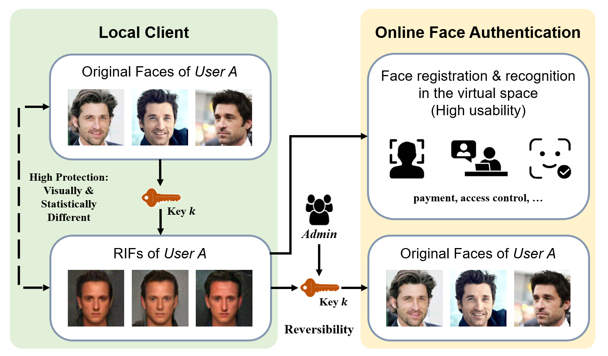
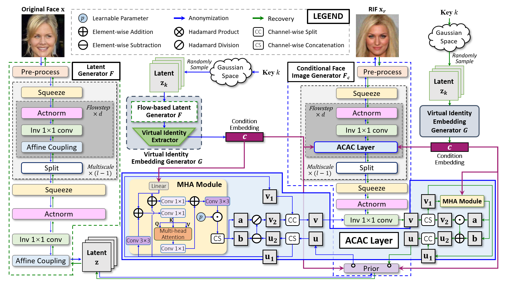
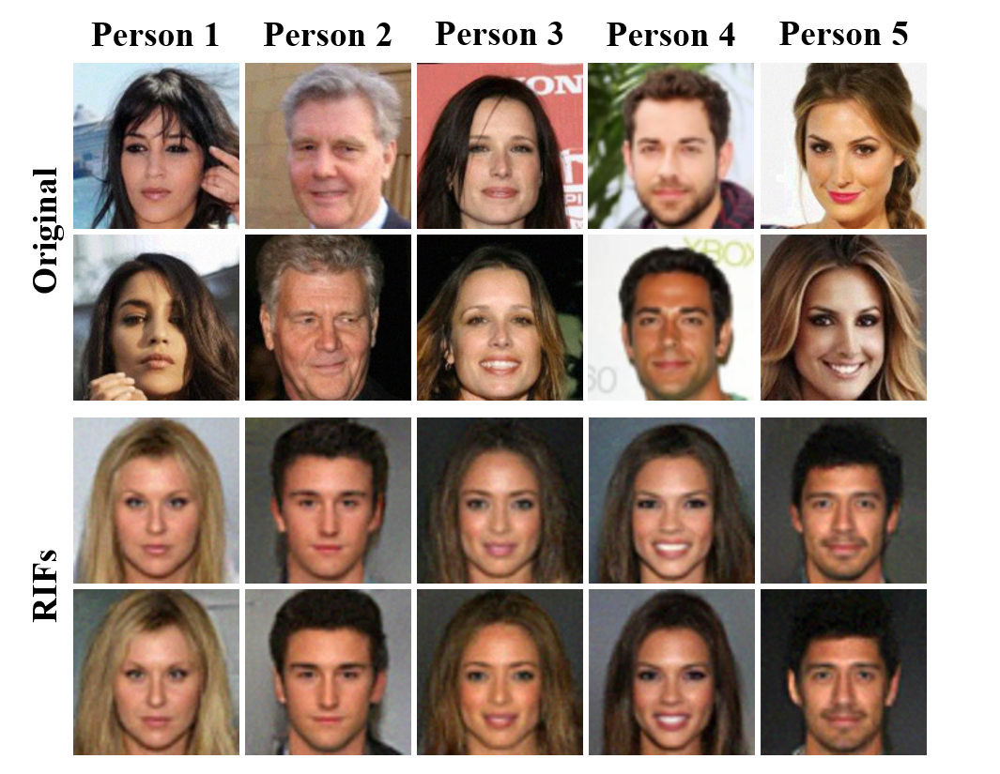
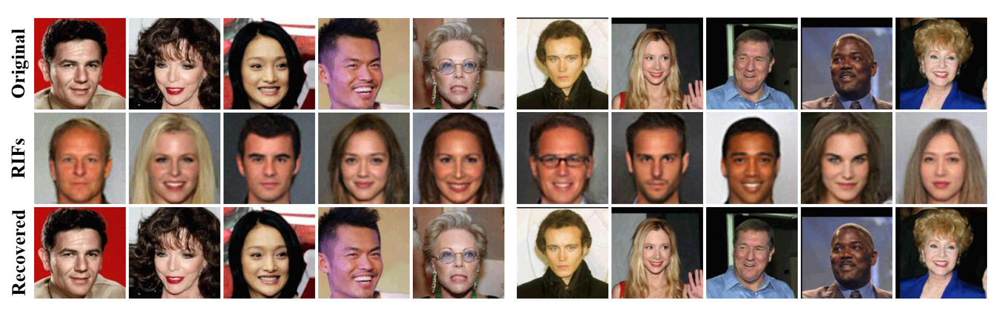

<div align="center">

# Generating Reversible and Identifiable Faces for Privacy Protection

Official PyTorch implementation of the paper published in **IEEE Transactions on Circuits and Systems for Video Technology (TCSVT), 2026**.

Xianhan Zeng · Gaozhi Liu · Sheng Li · Xinpeng Zhang · Jian Liu · Zhenxing Qian

[[IEEE Xplore](https://ieeexplore.ieee.org/abstract/document/11595688)]
[[DOI](https://doi.org/10.1109/TCSVT.2026.3710358)]
[[License: MIT](LICENSE)]
</div>

## Overview

RIFT (Reversible and Identifiable Face Transformer) generates a reversible and identifiable face (RIF) from an input face and a user-specific key. The generated face is visually and statistically different from the original face, can be authenticated directly through its virtual identity, and can be reversed to the original face using the correct key.

The method contains three main components:

- a flow-based latent generator for reversible image representation;
- a virtual-identity embedding generator that derives identity conditions from keys; and
- a conditional flow-based image generator with attention-based conditional affine coupling (ACAC) layers.

This design targets five properties discussed in the paper: anonymity, diversity, reversibility, identifiability, and non-transferability.

<p align="center">
  
  <br>
  <em>RIFT protects faces locally, supports authentication in a virtual-identity space, and permits authorized recovery with the correct key.</em>
</p>

<p align="center">
  
  <br>
  <em>RIFT architecture, including the flow-based latent generator, virtual-identity embedding generator, conditional image generator, and ACAC layer.</em>
</p>

## Highlights

- **Reversible privacy protection:** the original face can be reconstructed with the correct key.
- **Virtual-identity authentication:** protected faces generated with the same key share a recognizable virtual identity.
- **Key-controlled diversity:** different keys produce different protected identities for the same input.
- **Flow-based architecture:** the image transformation remains invertible while identity conditioning is strengthened by attention.

## Results reported in the paper

The following results are taken from the experiments reported in the paper. The public repository focuses on training and image generation; it does not include the complete metric, baseline, and security-attack evaluation suite used for the paper.

| Dataset | EER ↓ | AUC ↑ | PR ↑ | Diversity ↑ | Recovery PSNR ↑ | Recovery SSIM ↑ | Recovery LPIPS ↓ | IRR ↑ |
|:--|--:|--:|--:|--:|--:|--:|--:|--:|
| CelebA | 0.024 | 0.997 | 0.999 | 0.820 | 45.47 | 0.999 | 0.001 | 1.000 |
| LFW | 0.003 | 0.999 | 0.999 | 0.964 | 45.98 | 0.999 | 0.001 | 1.000 |

### Identifiability

<p align="center">
  
  <br>
  <em>Examples illustrating that protected faces can share a consistent and directly recognizable virtual identity.</em>
</p>

### Reversibility

<p align="center">
  
  <br>
  <em>From top to bottom: original faces, generated RIFs, and faces recovered with the correct key.</em>
</p>

Please refer to the [paper on IEEE Xplore](https://ieeexplore.ieee.org/abstract/document/11595688) for the full evaluation protocol, comparisons, ablation studies, and security analysis.

## Repository scope

This release contains:

- the three-stage training pipeline for Flow, conditional Flow, and RIFT fine-tuning;
- the attention-based CFlow used by the main method;
- the no-attention CFlow variant used in the ablation study;
- single-image and recursive folder inference; and
- a small utility for generating CelebA metadata files from an identity-classified image directory.

The full research archive also contains experiment-specific metric and attack code. Those files are intentionally excluded from this public release to keep the repository focused on training and practical image generation.

## Installation

Clone the repository and enter its directory:

```bash
git clone https://github.com/ThoseBygones/RIFT.git
cd RIFT
```

### Conda environment (recommended)

The provided environment file creates a small Python 3.8 environment. PyTorch and the remaining project dependencies are installed separately so that download progress and installation errors remain visible:

```bash
conda env create -f environment.yml
conda activate rift

python -m pip install -r requirements.txt \
  --prefer-binary \
  --timeout 120 --retries 10

# Reference CUDA 12.1 build used by the released environment
python -m pip install \
  torch==2.4.1 torchvision==0.19.1 \
  --extra-index-url https://download.pytorch.org/whl/cu121 \
  --only-binary=:all: \
  --timeout 120 --retries 10

python -m pip install facenet-pytorch==2.5.2 --no-deps
python -m pip check
```

The PyTorch wheel must be compatible with your operating system, GPU driver, and accelerator. Replace the reference CUDA 12.1 command with the appropriate command from the official PyTorch installation guide when necessary.

### Lightweight pip installation

Users who prefer an existing virtual environment should first install a compatible PyTorch/TorchVision pair, then install the remaining pinned dependencies and FaceNet:

```bash
python -m pip install -r requirements.txt --prefer-binary
python -m pip install facenet-pytorch==2.5.2 --no-deps
python -m pip check
```

The explicit FaceNet version and `--no-deps` flag are intentional: newer `facenet-pytorch` releases constrain PyTorch to an older version and may otherwise cause pip to replace the selected PyTorch/TorchVision pair.

The released models were designed for aligned face images and operate at `64 x 64` resolution. A CUDA-capable GPU is strongly recommended for training and practical inference.

## Pretrained models

Download the checkpoints from [Google Drive](https://drive.google.com/drive/folders/1btNyO9QB4vQgmqETvy1kgPPQmrDcnEUx?usp=drive_link) or [Baidu NetDisk](https://pan.baidu.com/s/1H_aV0AzDG0r8pZaESXJmSQ) (extraction code: `a73k`) and arrange them as follows:

```text
pretrained/
├── arcface.pt
├── flow.pt
├── cflow_attention.pt
└── rift.pt
```

For integrity checking, the expected files are:

| File | Size | SHA-256 |
|:--|--:|:--|
| `arcface.pt` | 250.6 MiB | `ec25cf494857a2d15ea58ad767d59d7d38a2b348f097622b57be4c0f9bc2c50b` |
| `flow.pt` | 117.6 MiB | `910023eb93c2e0d02db9c97187f7540739beb7dbffa75e606cad53b91b6ff6ab` |
| `cflow_attention.pt` | 199.1 MiB | `132258dc96b6265e9a10a0f513ec915edf811dfee0056f6efc3897c75ae6efd9` |
| `rift.pt` | 117.6 MiB | `84448cd442e0a44240bc4002bbcc204303ed6780d44378be095c0d7e63aa2693` |

The no-attention ablation checkpoint is not required for the main method. If you train or distribute it separately, place it at `pretrained/cflow_no_attention.pt` or pass its path explicitly.

## Quick inference

The inference entry point accepts either one image or a directory. Directory inputs are scanned recursively.

```bash
python inference.py \
  --input /path/to/input_image_or_directory \
  --output_dir ./outputs
```

To generate multiple virtual identities for each input image:

```bash
python inference.py \
  --input /path/to/images \
  --output_dir ./outputs \
  --num_outputs 5 \
  --seed 0
```

Results are written to:

```text
outputs/
├── original/
└── anonymized/
    └── ...
```

When `--num_outputs` is greater than one, the generated images are grouped under numbered subdirectories such as `anonymized/00/` and `anonymized/01/`. Run `python inference.py --help` for all available options, including custom checkpoint paths.

> The generated output is losslessly reversible only while the protected image values are preserved. Compression, resizing, cropping, filtering, or other post-processing may degrade or prevent exact recovery.

## Dataset preparation

Training currently supports CelebA arranged by identity. Downloading CelebA and complying with its license and terms of use are the user's responsibility.

The expected image layout is:

```text
/path/to/celeba/
└── celeba_classified/
    ├── identity_0001/
    │   ├── image_1.jpg
    │   └── image_2.jpg
    ├── identity_0002/
    │   └── ...
    └── ...
```

RIFT fine-tuning also reads metadata from `data_splits/celeba/`:

```text
data_splits/celeba/
├── list_celeba_val.txt
└── triples_celeba.txt
```

The repository-provided split files can be used with the corresponding identity-classified dataset. To regenerate metadata from your own identity folders, run:

```bash
python tools/prepare_celeba.py \
  --data_root /path/to/celeba \
  --output_dir ./data_splits/celeba
```

This utility scans an existing `celeba_classified/` directory and creates train, validation, test, and triplet lists. It does **not** convert the official flat CelebA image directory into identity folders. If you start from the original CelebA distribution, first group the aligned images by identity using the official identity annotations.

LFW is used only for evaluation in the paper and is not needed by the released training pipeline.

## Training

The model is trained in three stages. The commands below use the paper configuration encoded in the shell scripts. All paths may be overridden through environment variables.

### Stage 1: train the unconditional Flow

```bash
DATA_PATH=/path/to/celeba \
EXP_DIR=./experiments/flow \
bash scripts/train_flow.sh
```

Select the desired checkpoint from `experiments/flow/checkpoints/` and copy or rename it to `pretrained/flow.pt` before starting Stage 2.

### Stage 2: train the attention-based conditional Flow

```bash
DATA_PATH=/path/to/celeba \
FLOW_PATH=./pretrained/flow.pt \
ARCFACE_PATH=./pretrained/arcface.pt \
EXP_DIR=./experiments/cflow_attention \
bash scripts/train_cflow.sh
```

Place the selected result at `pretrained/cflow_attention.pt` before Stage 3.

### Stage 3: jointly fine-tune RIFT

```bash
DATA_PATH=/path/to/celeba \
METADATA_PATH=./data_splits/celeba \
FLOW_PATH=./pretrained/flow.pt \
CFLOW_PATH=./pretrained/cflow_attention.pt \
ARCFACE_PATH=./pretrained/arcface.pt \
EXP_DIR=./experiments/rift_attention \
bash scripts/train_rift.sh
```

The Stage 3 script follows the two-epoch fine-tuning schedule reported in the paper. Place the selected Flow checkpoint produced by this stage at `pretrained/rift.pt` for inference.

By default, Stage 3 uses FaceNet (`InceptionResnetV1`, pretrained on VGGFace2) for the identity-related losses, as described in the paper. The first run may download the FaceNet weights into the PyTorch cache. To retain compatibility with the later ArcFace-based training variant, run Stage 3 with:

```bash
IDENTITY_BACKBONE=arcface bash scripts/train_rift.sh
```

`arcface.pt` is required in both modes because the virtual-identity generator and CFlow conditioning remain ArcFace-based; `IDENTITY_BACKBONE` only selects the frozen recognizer used to compute the Stage 3 identity losses and validation scores.

Training options and a copy of the effective configuration are saved under each experiment directory. TensorBoard logs, validation images, and checkpoints are written below the same directory.

### No-attention ablation

The no-attention CFlow implementation is retained for ablation experiments:

```bash
CFLOW_VARIANT=no_attention \
DATA_PATH=/path/to/celeba \
FLOW_PATH=./pretrained/flow.pt \
ARCFACE_PATH=./pretrained/arcface.pt \
EXP_DIR=./experiments/cflow_no_attention \
bash scripts/train_cflow.sh
```

Use `CFLOW_VARIANT=no_attention` and set `CFLOW_PATH` to that checkpoint when running Stage 3 with the ablation variant.

## Project structure

```text
RIFT/
├── assets/                  # README figures
├── data_splits/celeba/      # CelebA validation and triplet metadata
├── dataset/                 # Training datasets
├── models/                  # Flow, CFlow, identity backbones, and identity generator
├── options/                 # Training command-line options
├── pretrained/              # Downloaded checkpoints (not tracked by Git)
├── scripts/                 # Reproducible three-stage training commands
├── tools/prepare_celeba.py  # Optional metadata generator
├── inference.py             # Single-image/folder inference
├── train_flow.py
├── train_cflow.py
├── train_rift.py
├── environment.yml          # Recommended reproducible Conda environment
├── LICENSE                  # MIT License
└── requirements.txt
```

## Limitations and responsible use

- The current implementation targets aligned `64 x 64` face images and is not intended as a high-resolution face synthesis system.
- Strict reversibility is sensitive to image post-processing and to correct key management.
- Face privacy and biometric authentication are security-sensitive applications. Evaluate the model under the transformations, threat model, demographics, and deployment conditions relevant to your use case.
- Do not use this code to impersonate individuals, bypass consent, or violate dataset licenses, privacy rights, or applicable law.

## Citation

If this work is useful in your research, please cite:

```bibtex
@article{zeng2026rift,
  title   = {Generating Reversible and Identifiable Faces for Privacy Protection},
  author  = {Zeng, Xianhan and Liu, Gaozhi and Li, Sheng and Zhang, Xinpeng and Liu, Jian and Qian, Zhenxing},
  journal = {IEEE Transactions on Circuits and Systems for Video Technology},
  year    = {2026},
  doi     = {10.1109/TCSVT.2026.3710358}
}
```

## License

This project is released under the [MIT License](LICENSE). The license permits use, modification, redistribution, and commercial use, provided that the copyright and license notices are retained.

The MIT License applies to the code in this repository. Pretrained third-party face-recognition weights and datasets remain subject to their respective licenses and terms of use.

## Acknowledgments

This work was supported in part by the CCF-Ant Research Fund. Please see the paper for complete acknowledgments and funding information.
